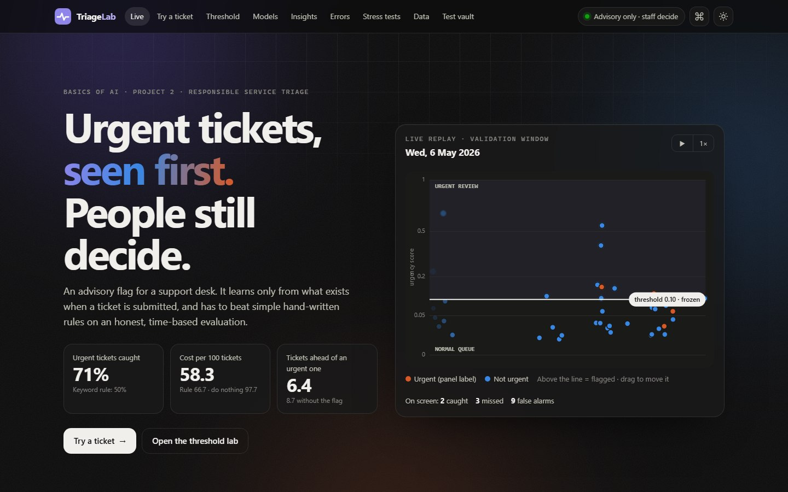
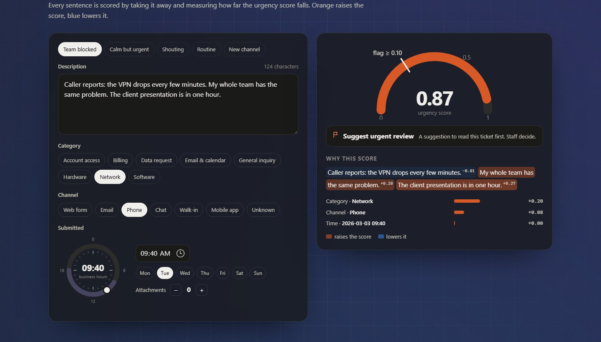
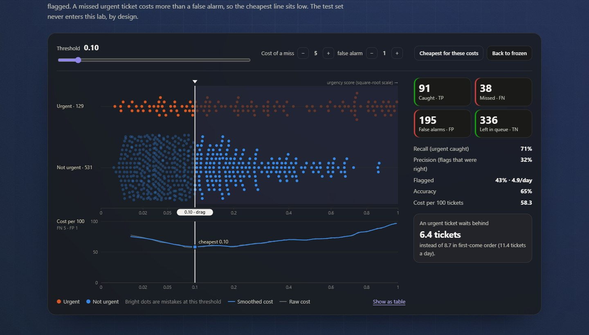

# Responsible Service Triage

An **advisory "urgent review" flag** for a support desk: Basics of Artificial Intelligence, Project 2 of 4 (labs L5–L8).

When a ticket arrives, the model suggests whether staff should look at it first. **It never refuses, closes or delays a request. A person always decides.** The goal is not the highest score. It is an honest evaluation that a real client could trust.



## Quick start

```bash
python -m pip install -r requirements.txt
python -m triage serve       # opens the control room at http://127.0.0.1:8000
```

The first `serve` trains the frozen model if it is missing (about half a minute). The interface needs no web framework, no Node and no build step: the server uses only the Python standard library and listens on this computer only.

## The control room

| Section | What it shows |
|---|---|
| **Live** | The validation window replayed in time. Tickets drift past at the height of their score; drag the line to move the threshold for every view on the page. |
| **Try a ticket** | Write a ticket, or pick an example, and get its score live. Each sentence is coloured by how much it moves the score (occlusion), next to the effect of category, channel and time. A 24-hour dial sets the submission time. |
| **Threshold lab** | All 660 validation tickets as dots, the cost curve on the same axis, the confusion matrix and the queue effect. All of them follow the draggable threshold and editable costs. Validation only, by design. |
| **Models** | The model ladder by cost, and every experiment with its cross-validation spread, the leakage demo included. |
| **Insights** | "Please treat as urgent." is urgent in 100% of training tickets; "URGENT!!!" in 6%. Tone, not the word. |
| **Errors** | Reliability diagram and the 12 most confident mistakes, each with its sentence-level explanation and a hypothesis. |
| **Stress tests** | Unseen channel, shouting, gaming, the real months and the real new channel, with recall / precision / cost deltas, plus recall by subgroup. |
| **Data** | Tickets per month across the three windows, the cleaning log, the leakage scan and the requester analysis. |
| **Test vault** | The sealed test set. It opens once, with a confirmation and a press-and-hold, then shows test against validation. |




Light and dark themes, a command palette (<kbd>Ctrl</kbd>+<kbd>K</kbd>), keyboard-operable controls, a table view behind every chart, reduced-motion support and a phone layout. Chart colours come from a colour-blind-validated palette: blue means not urgent, orange means urgent, on every chart.

## Command line

```bash
python -m triage audit       # L5 · columns, cleaning, leakage, requesters, drift -> reports/audit.md
python -m triage split       # L5 · freeze the time-based split -> data/split_manifest.json
python -m triage baselines   # L5 · two baselines on validation -> reports/baselines.md
python -m triage run         # L6–L7 · experiments, threshold, calibration, errors, shifts; freezes settings
python -m triage test        # L8 · shows how to open the sealed test set, exactly once
python -m triage serve       # the web interface (--port 8000, --no-browser)

python -m pytest             # 34 acceptance and interface checks
```

## Results on validation (May – Jun 2026)

| Model | Recall | Precision | Flagged | Cost / 100 tickets |
|---|---|---|---|---|
| Baseline 1 · Majority class | 0.00 | – | 0% | 97.7 |
| Baseline 2 · Keyword rule (impact + time pressure) | 0.50 | 0.35 | 28% | 66.7 |
| **Model A · Logistic regression, TF-IDF text + tone (selected, t = 0.10)** | **0.71** | **0.32** | **43%** | **58.3** |
| Model B · Random forest (t = 0.07) | 0.82 | 0.26 | 63% | 64.1 |
| Leakage demo with post-submission columns | CV AUC 0.985: too good to be true, never used | | | |

Costs: a missed urgent ticket = 5, a false alarm = 1, declared before modelling. The threshold is the minimum of the smoothed cost curve on validation. **The test set is still sealed**: it is opened once, in L8.

What the data teaches:

- **Impact and time pressure.** "This stops me from doing my job" and "the deadline is today" signal urgency.
- **Tone, not the word.** In training, "Please treat as urgent." is urgent 100% of the time. "URGENT!!!" is urgent 6% of the time and "Very urgent." 8%, against a 16% average. A rule on the word "urgent" therefore catches only 26% of urgent tickets.
- **Text carries the signal.** Without the description, average precision falls from 0.49 to 0.36.
- **Plausible shift.** The `mobile_app` channel appears in May 2026, after training. Recall on it is 0.43 against 0.71 overall.

## Deliverables (slide 9)

| Deliverable | Where |
|---|---|
| Code and environment file | `triage/`, `requirements.txt` |
| Experiment table | [`reports/experiments.md`](reports/experiments.md), `reports/experiments.csv` |
| Model card | [`reports/model_card.md`](reports/model_card.md) |
| Decision note | [`reports/decision_note.md`](reports/decision_note.md) |
| L5 audit · L7 validation · error analysis | [`audit.md`](reports/audit.md) · [`validation_report.md`](reports/validation_report.md) · [`error_analysis.md`](reports/error_analysis.md) |

## Acceptance checks

| Check | Proof |
|---|---|
| No future information in features | Column whitelist, plus a guard in `make_X` that refuses any post-submission source (`test_make_X_refuses_post_submission_sources`) |
| Reproducible split | Frozen manifest with SHA-256 fingerprints (`test_split_is_time_ordered_and_reproducible`) |
| At least two meaningful baselines | Majority class and keyword rule (`test_model_earns_its_place`) |
| Complete confusion matrix | TP / FN / FP / TN in every report (`test_confusion_matrix_is_complete`) |
| Threshold not chosen on the test set | The pipeline is run twice, once with **every test label flipped**: model and threshold come out identical (`test_threshold_and_model_do_not_depend_on_test_labels`) |
| At least ten inspected errors | 12 errors with hypotheses, in `reports/error_analysis.md` (`test_at_least_ten_errors_inspected`) |
| Intended and prohibited use | Model card (`test_reports_contain_intended_and_prohibited_use`) |
| Test used once | A lock is written before scoring; a second run is refused (`test_test_set_is_used_exactly_once`) |

## The data

`data/tickets.csv` is the instructor's synthetic export (3,012 rows, September 2025 – August 2026), described in [`data/DATA_DICTIONARY.md`](data/DATA_DICTIONARY.md). It is fully synthetic and permitted for coursework and portfolio use. No real tickets are involved.

The export was deliberately left uncleaned. Every cleaning rule works row by row and never uses the label, so it is safe to apply before the split:

| Problem found | Fix |
|---|---|
| 12 duplicated rows | dropped |
| 38 inconsistent category spellings (`ACCOUNT_ACCESS`, ` software`, `data request`) | normalised to 8 categories |
| 60 missing channels | 12 recovered from the staff prefix (`Caller reports:` = phone, `Walk-in:` = walk-in), 48 set to `unknown` |
| 30 missing `description_length` | recomputed from the text, which matches on every other row |

## Non-negotiables and how the code enforces them

| Rule | Enforcement |
|---|---|
| **Submission-time information only** | A whitelist column policy (`triage/data.py`). `assigned_priority`, `handling_team` and `resolution_hours` are set after triage and are excluded. On their own they reach AUC 0.93 / 0.73 / 0.94, which is too good to be true. Undocumented columns are excluded by default. |
| **Test set used once** | The split is frozen in `data/split_manifest.json` with SHA-256 fingerprints. Test IDs are stored only as a hash, and no development function can return test rows. |
| **Approved data only** | Only the instructor's file. Its fingerprint is checked before every run. |
| **Advisory only** | The output is a suggestion to re-order the queue, never an action. |

## Split

| Window | Months | Tickets |
|---|---|---|
| Train | Sep 2025 – Apr 2026 | 1,784 |
| Validation | May – Jun 2026 | 660 |
| Test (sealed) | Jul – Aug 2026 | 556 |

The model will score **future** tickets, so the split follows time. 95% of later tickets come from requesters already seen in training, and removing them would delete 88% of the training data. Their urgency rate varies no more than chance predicts, so requesters carry no urgency of their own. Inside training, cross-validation folds are **grouped by requester**. The full argument is in [`reports/audit.md`](reports/audit.md).

## Project layout

```
data/        instructor's CSV, data dictionary, frozen split manifest
triage/      the Python package (python -m triage ...)
  data.py      column policy and cleaning        split.py     frozen time-based split
  features.py  submission-time model inputs      baselines.py majority class, keyword rule
  models.py    the model ladder and grouped CV   evaluate.py  metrics, cost, threshold, calibration
  analysis.py  errors, shifts, subgroups, queue  explain.py   which sentence raised the score
  pipeline.py  L6–L7, freezes the settings       final.py     L8 one-shot test
  server.py    local web server (standard library) dashboard.py data for the interface
web/         the control room: index.html, styles.css, js/ (ES modules, no build step)
artifacts/   frozen_config.json (versioned); the model itself is rebuilt by `run`
reports/     generated, human-readable deliverables
tests/       acceptance and interface checks (pytest)
docs/        Romanian explanation of the project brief, screenshots
```

## Pe scurt (RO)

Un semnal consultativ „urgent review” pentru tichetele unui help desk. Modelul doar sugerează ce citește personalul mai întâi; decizia rămâne la un om. Pornire: `python -m pip install -r requirements.txt`, apoi `python -m triage serve`. Setul de test este încă sigilat și se deschide o singură dată, în L8, din „Test vault” sau cu `python -m triage test`. Explicația completă a proiectului, în română: [`docs/P2_Explicatie_Responsible_Service_Triage.md`](docs/P2_Explicatie_Responsible_Service_Triage.md).
